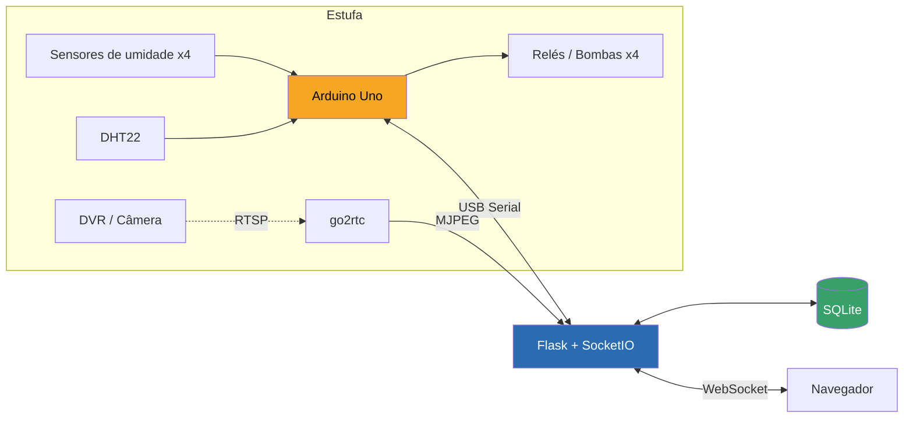

<a href="https://trendshift.io/repositories/19809?utm_source=repository-badge&amp;utm_medium=badge&amp;utm_campaign=badge-repository-19809" target="_blank" rel="noopener noreferrer"></a>

# 🌱 GreenHouse

Dashboard web em tempo real para monitoramento e rega automática de estufa, com Arduino conectado via USB, sensores de umidade do solo, temperatura/umidade do ar e controle de bombas por vaso.


---

## Índice

- [Visão geral](#visão-geral)
- [Funcionalidades](#funcionalidades)
- [Arquitetura](#arquitetura)
- [Como rodar](#como-rodar)
- [Configuração](#configuração-env-no-coolify)
- [Páginas do dashboard](#páginas)
- [Protocolo Arduino ⇄ Python](#protocolo-serial-python--arduino)
- [Detalhes técnicos e decisões de projeto](#detalhes-técnicos-e-decisões-de-projeto)
- [Projetos relacionados](#projetos-relacionados)
- [Deploy](#deploy)

---

## Visão geral

O GreenHouse lê dados de um Arduino (sensores de umidade do solo, DHT22,
controle de bombas) conectado via USB ao servidor, exibe tudo em tempo
real via WebSocket e mantém histórico completo em SQLite. Suporta de 1 a
4 vasos, cada um com sua própria quantidade de sensores/bombas
configurável direto pela interface web — sem precisar regravar o Arduino
a cada mudança de layout na estufa.

- **Domínio**: `greenhouse.gvtserver.online`
- **Porta interna**: `4022`
- **Pasta no servidor**: `/pendriver/greenhouse`
- **Dados persistentes**: `/pendriver/greenhouse_hist` (SQLite)

## Funcionalidades

- 📊 **Painel em tempo real** — gráficos por vaso via WebSocket (Flask-SocketIO), sem polling.
- 🪴 **Topologia flexível** — de 1 a 4 vasos, cada um com sua própria combinação de sensores/bombas; modo avançado permite sensor e bomba do mesmo slot físico pertencerem a vasos diferentes.
- 💧 **Rega automática e manual** — por tempo + umidade, com teto de segurança de tempo máximo por ciclo; controles manuais por vaso, teste de bombas individual e sequencial.
- 🔌 **Detecção de sensor desconectado/instável** — filtra ruído de pino flutuando e nunca dispara rega sem leitura confiável.
- 📷 **Câmera ao vivo** — stream MJPEG de um DVR local (RTSP) embutido no dashboard, via `go2rtc`.
- 📈 **Histórico e relatórios** — leituras por período, médias, distribuição de VPD, exportação CSV.
- 📱 **PWA + layout responsivo** — sidebar no desktop, menu flutuante no mobile, instalável como app.
- 🔐 **Login simples** — autenticação por usuário/senha via variáveis de ambiente.
- 🩺 **Auto-recuperação** — reconexão automática do Arduino (hot-plug), configuração persistida em EEPROM, healthcheck para orquestração via Docker.

## Arquitetura



## Como rodar

### Localmente (sem Docker)

```bash
python3 -m venv venv
source venv/bin/activate
pip install -r requirements.txt

cp .env.example .env   # edite com suas credenciais
python3 app.py
```

Sem Arduino conectado, o app sobe normalmente e mostra "Offline" — a
thread de conexão fica tentando em background sem travar o servidor web.

### Com Docker (produção)

Ver seção [Deploy](#deploy) — pensado para rodar atrás de Coolify + Traefik,
com o Arduino plugado via USB no host.

## Configuração (`.env` no Coolify)

Ver `.env.example`. **Nunca** commitar o `.env` real (já está no `.gitignore`).

| Variável | Uso |
|---|---|
| `PORT` | Porta HTTP interna (padrão `4022`) |
| `GREENHOUSE_USERNAME` / `GREENHOUSE_PASSWORD` | Login do dashboard |
| `GREENHOUSE_SESSION_SECRET` | Chave de sessão Flask (gerar com `openssl rand -hex 32`) |
| `GREENHOUSE_HIST_DIR` | Pasta onde o SQLite é gravado dentro do container (mapear para volume persistente) |
| `GREENHOUSE_SERIAL_PORT` | Override manual da porta serial (opcional) |
| `GREENHOUSE_GO2RTC_URL` / `GREENHOUSE_CAMERA_STREAM` | Opcional, câmera via go2rtc (ver detalhes abaixo) |

## Páginas

| Rota | Descrição |
|---|---|
| `/` | Painel — um card por vaso com gráfico próprio, status Online/Offline do Arduino, câmera ao vivo |
| `/historico` | Leituras brutas por período |
| `/relatorios` | Resumo agregado (regas, VPD/temp/umidade médios, distribuição de VPD) + exportar CSV |
| `/configuracoes` | Modo Vega/Flora, limiares/intervalo/volume, topologia de vasos/sensores, controles manuais, reiniciar Arduino |

## Protocolo serial (Python ⇄ Arduino)

Protocolo texto simples, uma linha por comando/resposta, terminado em `\n`.

**Python → Arduino:**
- `CFG:LOW=45;HIGH=65;INTERVALO=120;VOLUME=1000;MODO=VEGA;AUTO=1` — aplica config completa.
- `GET_CFG` — Arduino responde com a config atual, mesmo formato.
- `TOPO:N=3;S0=1;S1=1;S2=2;S3=3;B0=1;B1=1;B2=2;B3=0` — aplica topologia (S=sensor, B=bomba, independentes).
- `GET_TOPO` — Arduino responde com a topologia atual.
- `REGAR:<vaso>` — dispara rega manual.
- `PARAR` — interrompe qualquer rega em andamento.
- `TESTE_BOMBAS:LIGAR`/`DESLIGAR` — teste sequencial das 4 bombas.
- `TESTE_BOMBA:LIGAR:<slot>`/`DESLIGAR` — liga/desliga uma bomba específica manualmente.
- `REINICIAR` — reset remoto via watchdog.

**Arduino → Python (telemetria):**
```
DADOS:VASOS=3;U1=62;U2=58;U3=71;ULTIMA=3;PROXIMA=45;TEMP=24.1;UMI=55.3;VPD=1.12;VPDC=Flora IN;AUTO=1
```
Mais `REGA_INICIO:<vaso>:<motivo>` e `REGA_FIM:<vaso>:<motivo>:<duração_s>:<umidade_final>:<causa>`,
persistidos na tabela `rega_eventos`.

> ⚠️ O `.ino` não foi compilado com `arduino-cli` neste ambiente de
> desenvolvimento — revisão manual cuidadosa, mas compile e teste no
> Arduino IDE / hardware real antes de confiar em produção.

## Detalhes técnicos e decisões de projeto

<details>
<summary><strong>Topologia flexível de vasos/sensores/bombas</strong></summary>

<br>

O hardware tem **4 sensores de umidade fixos** (A0-A3) e **4 relés/bombas
fixos** (pinos 8-11) — isso não muda. O que é configurável é a quais
vasos esses sensores e bombas pertencem: de 1 até 4 vasos, cada um com
uma quantidade diferente de sensores/bombas.

**Modo simples (padrão)**: cada slot físico (sensor+bomba juntos)
pertence a um único vaso. Um slot pode ficar **desativado** ("Não usar")
quando o número de vasos não usa todos os 4 slots físicos.

**Modo avançado** (toggle em Ajustes): sensor e bomba de um mesmo slot
podem pertencer a vasos **diferentes**, ou um vaso pode ter só sensor
(monitoramento) ou só bomba. A página detecta sozinha se a topologia
salva já usa esse modo e abre com o toggle já ligado.

Configuração pela página **Ajustes** → "Vasos e sensores". Depois de
salvar, recarregue a página para os controles manuais refletirem os
vasos novos.

No LCD, a tela de vasos mostra até 2 por vez, entrando num rodízio de 3
telas (temp/umidade/VPD → vasos 1-2 → vasos 3-4) quando há mais de 2
vasos configurados.

</details>

<details>
<summary><strong>Rega bloqueia o Arduino inteiro — cuidados e mitigação</strong></summary>

<br>

Enquanto uma rega (manual ou automática) está em andamento, o firmware
fica preso dentro do controle por pulsos (liga 20s, espera 30s de
absorção, repete). Durante esse tempo, a telemetria (`DADOS:`) é enviada
a cada segundo mesmo durante a rega — sem isso, o Arduino parecia
"travado" no dashboard.

O tempo de bloqueio, na pior hipótese (sensor nunca atinge a umidade de
corte), é `volume_ml / (15,63 × bombas do vaso)` segundos de bomba
**ativa**, distribuído em ciclos de 20s ligada + 30s de absorção — ou
seja, o tempo real é ~2,5× esse valor. Por segurança, existe um **teto de
5 minutos de bomba ativa** (`TEMPO_MAXIMO_REGA_MS`) — nenhuma rega
bloqueia além disso. O log da rega (`REGA_FIM:...:TEMPO_MAXIMO_ATINGIDO`)
deixa explícito quando foi o teto (não o volume) que encerrou o ciclo —
sinal de que o volume configurado está alto demais para a vazão das
bombas.

O app Python também espelha se o Arduino está "ocupado" (rega, teste de
bombas, ou bomba manual ligada), atualizado a partir das próprias
mensagens que o Arduino manda. As rotas de comando checam isso **antes**
de mandar o comando, respondendo com erro 409 em vez de um falso
"sucesso" se algo já estiver em andamento.

</details>

<details>
<summary><strong>Detecção de sensor desconectado/instável</strong></summary>

<br>

Um pino analógico sem sensor (flutuando) capta ruído elétrico e varia
muito entre leituras tiradas com poucos ms de diferença — um sensor de
verdade não muda de umidade nesse intervalo tão curto.

- Cada leitura é uma mediana de 7 amostras; a diferença entre a maior e a
  menor amostra (`spread`) acima de `LIMITE_SPREAD_INSTAVEL` conta como
  "instável" naquela rodada.
- Depois de `LIMIAR_DEBOUNCE` rodadas seguidas instáveis, o slot é
  marcado como desconectado.
- Vasos sem sensor confiável retornam `-1` — **nunca** `0%` (não seria
  confundido com "solo bem molhado") e nunca dispara rega automática.
- Sensores conectados passam por suavização extra (média móvel
  exponencial) contra ruído elétrico/chaveamento de relé.

Isso aparece no LCD ("Sem sensor"), no dashboard (aviso amarelo + gráfico
pula o ponto, sem linha reta em 0%) e na lógica de rega automática.

</details>

<details>
<summary><strong>Câmera ao vivo (DVR via go2rtc)</strong></summary>

<br>

O dashboard mostra vídeo ao vivo de uma câmera ligada a um DVR na rede
local (testado com Intelbras HDCVI, mas qualquer DVR com RTSP serve).

`go2rtc` (container `alexxit/go2rtc`) puxa o stream **RTSP** do DVR e
reencaminha como **MJPEG**. O Flask faz o proxy em `/camera/stream`,
protegido pelo mesmo login do resto do app — `go2rtc` não tem
router/labels do Traefik, só é alcançável dentro da rede Docker interna.

**Configuração:**
1. Copiar `go2rtc.yaml.example` para `go2rtc.yaml` (gitignored — nunca
   commitar com credenciais reais) e trocar a URL RTSP pela do seu DVR.
2. Testar a URL primeiro no VLC antes de plugar no app.
3. A câmera manda vídeo em H264 — o endpoint MJPEG do go2rtc não converte
   sozinho, por isso a fonte usa `ffmpeg:rtsp://...#video=mjpeg`.
4. Qualquer mudança no `go2rtc.yaml` exige `docker restart greenhouse-go2rtc`.

Parâmetros de qualidade (`#raw=-q:v N -r N`): `-q:v` de `2` (quase sem
perda) a `31` (pior/mais leve); `-r` é o FPS entregue ao navegador.

**Não precisa redirecionar porta nenhuma no roteador** — o servidor já
está na mesma rede local que o DVR.

</details>

<details>
<summary><strong>Persistência em EEPROM e rega automática (toggle)</strong></summary>

<br>

O Arduino grava config e topologia na EEPROM assim que recebe um `CFG:`/
`TOPO:` válido, e lê de lá logo no início do `setup()` — antes de
qualquer tela do LCD. Isso evita depender do timing exato do Python
reenviar a config depois de cada boot (o LCD tem telas de splash com
~15s de espera antes do Arduino processar comandos seriais). O SQLite
continua sendo a referência do lado Python, reenviando `CFG:`/`TOPO:` a
cada reconexão como sincronização de segurança.

O toggle **"Rega automática"** em Ajustes desliga a checagem por
tempo/umidade — só rega quando mandado manualmente. Reativar reinicia a
contagem do intervalo do zero, não dispara uma checagem na hora.

</details>

<details>
<summary><strong>Auto-detecção da porta serial e privilégios do container</strong></summary>

<br>

Em vez de uma porta fixa, o `app.py` varre as portas seriais disponíveis
e escolhe a que bate com VID:PID conhecidos de chips USB-serial de
Arduino (CH340, FTDI, CP210x, Arduino genuíno). Suporta hot-plug — se o
Arduino for plugado depois do container já estar rodando, o loop de
reconexão (a cada 5s) encontra ele sozinho.

O container roda com `privileged: true` + `/dev` montado inteiro —
necessário porque o Docker isola devices por padrão, e essa é a opção
mais simples e robusta a hot-plug. Trade-off aceitável em servidor
pessoal de uso doméstico; para reforçar isolamento, dá para trocar por
uma regra `udev` com symlink fixo no futuro.

</details>

<details>
<summary><strong>Layout responsivo (sidebar/mobile) e PWA</strong></summary>

<br>

- **Desktop (≥768px)**: sidebar fixa à esquerda com os itens de
  navegação, badge de status e "Sair" no rodapé.
- **Mobile (<768px)**: a sidebar vira um menu flutuante (`.bottom-nav`),
  uma pílula fixa embaixo com os mesmos itens. Troca sidebar ↔
  bottom-nav é só CSS (media query), sem JS.
- **Gestos**: `static/swipe.js` implementa swipe horizontal via touch
  events puro (limiares: 70px de distância mínima, 700ms de duração
  máxima, dominância horizontal 1.3x).
- **PWA**: `static/manifest.json` (rota dedicada `/manifest.json` com
  mimetype correto) + `static/sw.js` (service worker mínimo, só pra
  satisfazer o requisito de instalabilidade, sem cache agressivo pra não
  interferir com Plotly/Socket.IO carregados via CDN).

</details>

## Projetos relacionados

Este repositório documenta a versão **em produção** (Arduino Uno + USB).
Dois projetos complementares (fora deste repo) exploram o próximo passo
e a documentação do hardware atual:

- **`greenhouse-esp32/`** — proposta de nova geração: ESP32 com WiFi (sem
  cabo USB até o servidor), PCB organizada, arquitetura de firmware com
  duas tarefas (WiFi/HTTP nunca trava esperando a rega terminar).
- **`greenhouse-arduino-atual/`** — documentação de referência da fiação
  física atual (pinout, BOM, guia de religação), para manutenção sem
  precisar reabrir o código.

## Deploy

1. Copiar esta pasta para `/pendriver/greenhouse` no servidor.
2. Criar `/pendriver/greenhouse_hist` (histórico persistente).
3. Configurar o `.env` no Coolify com base em `.env.example`.
4. Adicionar/atualizar o bloco de `dynamic-proxy.yaml` no Traefik (file provider), se aplicável.
5. Subir o stack no Coolify.
6. Plugar o Arduino via USB no servidor e conferir `docker logs greenhouse`.
7. Testar `https://greenhouse.gvtserver.online` e `/health`.

---

<sub>Repositório privado — uso pessoal.</sub>
